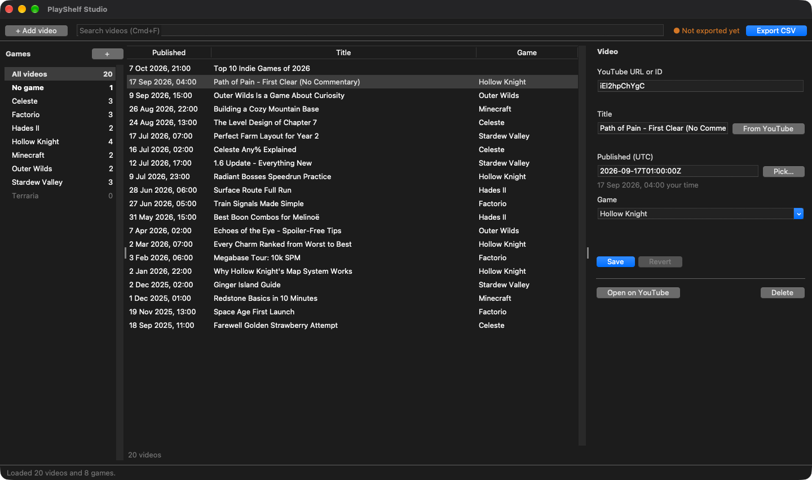
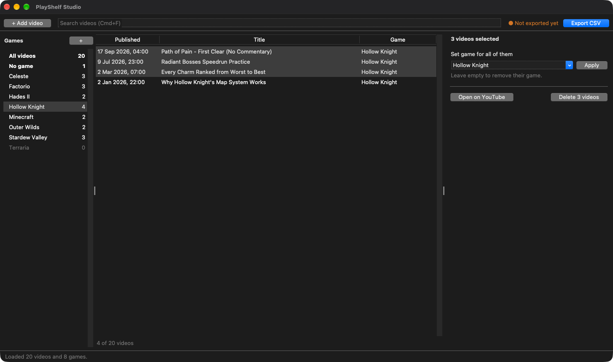

# PlayShelf Studio

A desktop catalog editor for **PlayShelf**, a hand-picked collection of YouTube
videos from any creators, grouped by game. Use it to manage the games list and
the videos, then export the `videos.csv` that the PlayShelf site serves.

It runs on Windows, macOS and Linux. It uses only the Python standard library
(Tkinter), and you can build it into a single standalone executable.



## Features

- **Games sidebar** with video counts. It doubles as a filter: *All videos*,
  *No game*, or one game. You can rename or delete a game, and the change
  carries over to its videos.
- **Video list** with live search (title, game or id) and sortable columns.
- **Details pane** for editing one video, or for setting the game of or
  deleting several videos at once.

  

- **Paste a YouTube link** (any `youtube.com` / `youtu.be` URL or a bare
  11-character id). The title fills in automatically from YouTube's oEmbed
  endpoint. You don't need an API key.
- **Undo / redo** for every change, up to 100 steps.
- **Safe storage**: atomic writes, an automatic backup before an import, and
  conflict detection if the data files change on disk (for example, a second
  copy of the app, or Excel).
- **Export status** in the toolbar shows whether the site CSV is up to date.

## Running from source

You need Python 3 with Tkinter. Python 3.14 is used for development.

```sh
python -m playshelf_studio
```

You don't need any third-party packages to run it.

## Building the executable

```sh
pip install -r requirements.txt
python build.py                        # version from env / Git tag / clock
python build.py v2026.10.08-build203015
```

| OS      | Output in `dist/`                          |
| ------- | ------------------------------------------ |
| Windows | `PlayShelfStudio.exe` (single file)        |
| Linux   | `PlayShelfStudio` (single file)            |
| macOS   | `PlayShelfStudio.app` (app bundle)         |

PyInstaller can't cross-compile, so build on each OS you want to ship for. The
version comes from the command-line argument, then `$PLAYSHELF_STUDIO_VERSION`,
then the GitHub Actions tag, then the current time.

### Continuous integration and releases

`.github/workflows/build.yml` runs the tests on Linux, Windows and macOS for
every push and pull request. It then builds the app for all six targets:
macOS, Windows and Linux, each on x64 and arm64. You can download the builds
from the run's **Artifacts**.

The tag becomes the app's version, and a GitHub Release is created with all
six builds attached:

| File                                         | Contents                                 |
| -------------------------------------------- | ---------------------------------------- |
| `PlayShelfStudio-<tag>-macos-<arch>.zip`     | `PlayShelfStudio.app`, signed and notarized |
| `PlayShelfStudio-<tag>-windows-<arch>.exe`   | single-file executable, signed           |
| `PlayShelfStudio-<tag>-linux-<arch>.tar.gz`  | single-file executable                   |

### Code signing

CI signs the macOS and Windows builds on pushes and tags (not on pull
requests), as long as the secrets below are set. If they're missing, the
builds are still produced: macOS gets an ad-hoc signature and Windows stays
unsigned, so Gatekeeper and SmartScreen warn on first launch.

**macOS.** `build.py` signs with a Developer ID certificate under the
hardened runtime (`packaging/entitlements.plist`), notarizes, and staples.
In CI, set these repository secrets:

| Secret                       | Value                                                        |
| ---------------------------- | ------------------------------------------------------------ |
| `MACOS_CERTIFICATE_P12`      | `base64 -i DeveloperID.p12`: Developer ID Application cert and its private key |
| `MACOS_CERTIFICATE_PASSWORD` | the password of that `.p12`                                  |
| `APPLE_API_KEY_P8`           | contents of the App Store Connect `AuthKey_<id>.p8`          |
| `APPLE_API_KEY_ID`           | that key's id                                                |
| `APPLE_API_ISSUER_ID`        | the issuer id shown above the keys list                      |

To build locally, set `MACOS_CODESIGN_IDENTITY` and either
`NOTARY_KEYCHAIN_PROFILE` (from `xcrun notarytool store-credentials`) or the
`NOTARY_API_KEY_*` variables. See the docstring at the top of `build.py`.

**Windows.** [SignPath](https://signpath.io) signs the executable. CI
uploads it as an artifact and submits a signing request. Tags use the
`release-signing` policy, which waits for an approver in SignPath. Other
pushes use `test-signing`. Set the secret `SIGNPATH_API_TOKEN` (a CI user
with submitter rights) and the repository variables `SIGNPATH_ORGANIZATION_ID`
and `SIGNPATH_PROJECT_SLUG`. The project's artifact configuration is
`packaging/signpath-artifact-configuration.xml`.

#### Code signing policy

Free code signing provided by [SignPath.io](https://about.signpath.io),
certificate by [SignPath Foundation](https://signpath.org).

- Committers and reviewers: [members of KostelidisDev](https://github.com/orgs/KostelidisDev/people)
- Approvers: [owners of KostelidisDev](https://github.com/orgs/KostelidisDev/people?query=role%3Aowner)

Privacy: this program connects to only one networked system. When you paste
a YouTube link, it asks YouTube's oEmbed endpoint for the video's title. It
sends no other information.

## Data

Data lives in plain CSV files in the per-user data folder:

| OS      | Folder                                                     |
| ------- | ---------------------------------------------------------- |
| Windows | `%APPDATA%\PlayShelfStudio`                                |
| macOS   | `~/Library/Application Support/PlayShelfStudio`            |
| Linux   | `$XDG_DATA_HOME/playshelf-studio` (`~/.local/share/...`)   |

Set `PLAYSHELF_STUDIO_DATA_DIR` to use a different folder.

```
games.csv      title
videos.csv     video_id, title, published_at, game_title
settings.json  UI conveniences (last folders, last export)
backups/       snapshots taken before each import (last 20 kept)
logs/          playshelf-studio.log (rotated)
```

### Site CSV format

The export has the columns `video_id,title,published_at,game_title`. It is
UTF-8 with a BOM, sorted newest first, and `published_at` uses the format
`YYYY-MM-DDTHH:MM:SSZ` (UTC). In titles, commas become `;` and double quotes
become `'`, so no row ever needs quoting. **These columns are the contract with
the PlayShelf site.**

## Development

```sh
python -m unittest            # run the test suite
python -m unittest -v tests.test_library
```

See [CLAUDE.md](CLAUDE.md) for the architecture and conventions.

## License

[MIT](LICENSE.md)
